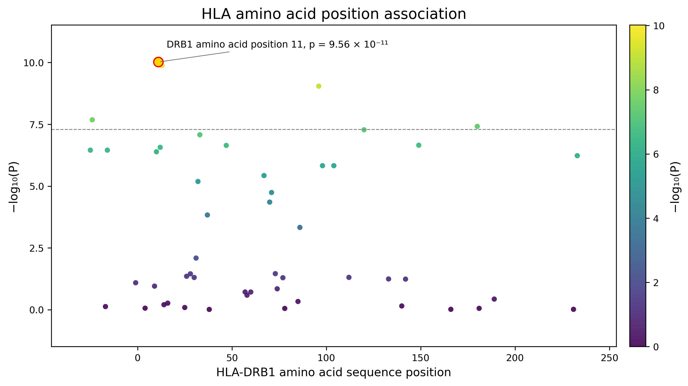
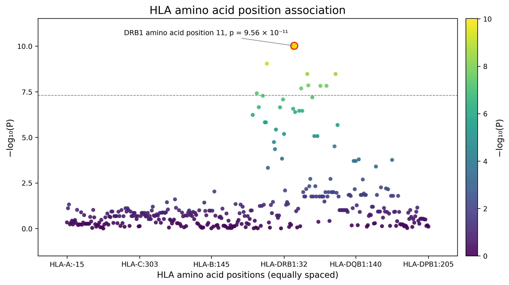
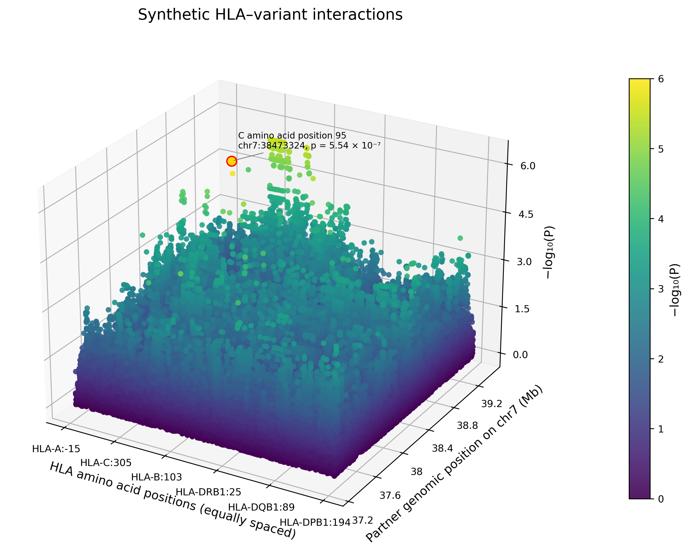

# HLA amino acid position visualisation

Visualisation plays an important role in genetic association studies, helping 
researchers identify association signals, explore patterns across genomic regions 
and communicate their findings. While Manhattan plots provide an overview of 
association significance across genetic positions, three-dimensional (3D) interaction 
plots offer a way to visualise interactions between HLA amino acid variation and other 
genetic components.

To facilitate the interpretation and presentation of these results, `hapy` provides 
two visualisation functions: a Manhattan plot for HLA amino acid associations `hp.vis.plot_aa_association()`
and a 3D interaction plot `hp.vis.plot_aa_interaction()` for exploring genetic interaction signals.

Both of them returns `(fig, ax)`.

[Matplotlib](https://matplotlib.org/stable/api/markers_api.html) is the only plotting dependency. Plots are not displayed unless `show=True`.

## Input and significance

## Input and significance

Both plotting functions accept amino acid position-level association results. Variant IDs such as `AA_DRB1_11_32552129` identify the HLA gene, amino acid position and genomic coordinate. Residue-level results (`OVR`) should be excluded before plotting.

Use `variant_col="VARIANT"` and either `pval_col="P-value"` for association results or `log10p_col="META_log10P"` for meta-analysis results.

Very small P-values (e.g. `6.09e-412`) can be supplied as strings to avoid numerical underflow. Alternatively, use `log10p_col` with precomputed −log₁₀(P) values.

Genomic coordinates must use a consistent reference build. `reference_build` adds a genome-build label but does not convert coordinates.

## Choosing the X-axis

The same `x_axis` options are available for `plot_aa_association()` and both
`plot_aa_interaction()` modes (`scatter3d` and `heatmap`):

| `x_axis` | Spacing and meaning | Gene selection |
|---|---|---|
| `"amino_acid"` **(default)** | Numeric amino acid sequence positions; gaps reflect differences in sequence position. | Select one gene, e.g. `genes="DRB1"`. |
| `"genomic"` | Actual genomic base-pair coordinates. Positions within genes cluster because inter-gene gaps are much larger. | One or multiple genes. |
| `"equally_spaced"` | Distinct AA positions are ordered by genomic coordinate and spaced evenly, like categorical string plotting. Spacing represents neither genomic nor sequence distance. | One or multiple genes. |

For example, add one of these configurations to either plotting function:

```python
# Numeric sequence positions within HLA-DRB1 (the default axis).
x_axis = "amino_acid"
genes = "DRB1"
```




```python
# Physical genomic spacing across HLA genes.
x_axis="genomic"

# Even spacing across HLA positions, with gene/position tick labels.
x_axis="equally_spaced"
```



For interaction plots, the partner Y-axis always represents genomic coordinates. Use `position_unit="Mb"` to display genomic coordinates in megabases. The `equally_spaced` option is intended for visual comparison and does not represent physical distances.

## Association plot

This is for plotting amino acid position associations results.

```python
import pandas as pd
import hapy as hp

association = pd.read_csv("examples/visualisation/association.csv")
fig, ax = hp.vis.plot_aa_association(
    association, x_axis="equally_spaced", variant_col="VARIANT", log10p_col="META_log10P",
    highlight_top=True, annotate_p=True, position_unit="Mb",
    title="HLA amino acid position association",
    significance_threshold=5e-8, save_path="association.png",
)

```




`highlight_top=True` selects the strongest hit; `highlight_top=3` selects three.
`highlights=[("B", 63), ("DRB1", 11)]` selects gene and sequence-position pairs;
exact position IDs are also accepted. Gene is always part of tuple matching.
`genes="DRB1"` or `genes=["B", "DPB1"]` filters before selecting top hits.
Multiple coordinates for a selected gene/sequence position are all highlighted.
Missing requested highlights produce a warning.

`significance_threshold` accepts actual P-values (including scientific-notation
strings); `threshold_log10p` instead accepts −log₁₀(P). Either accepts a scalar or
list. `threshold_kwargs` customises the Matplotlib horizontal lines.

## Interaction scatter and sparse heatmap

This is for plotting GxG (amino acid positions and SNP) interaction results.

```python
from matplotlib.colors import Normalize

interactions = pd.read_csv("examples/visualisation/interaction.csv")
hits = [("B", 63, 38175678), ("DPB1", 9, 37289819), ("DPB1", 35, 37289819)]
shared_scale = Normalize(vmin=0, vmax=6)
for kind in ["scatter3d", "heatmap"]:
    fig, ax = hp.vis.plot_aa_interaction(
        interactions, x_axis="genomic", variant_col="AA_VARIANT", partner_pos_col="TCR_POS",
        partner_variant_col="PARTNER", log10p_col="META_log10P",
        kind=kind, highlights=hits, annotate_p=True, position_unit="Mb",
        norm=shared_scale, figsize=(12, 7), annotation_fontsize=8,
        annotation_offsets={
            ("B", 63, 38175678): (8, 12),
            ("DPB1", 9, 37289819): (-230, 45),
            ("DPB1", 35, 37289819): (-230, 95),
        },
        save_path=f"interaction_{kind}.pdf",
    )
```

The X-axis represents HLA amino acid positions, while the Y-axis represents partner genomic coordinates. In 3D plots, height and colour represent −log₁₀(P).

Partner coordinates can be extracted from variant IDs such as `chr7:38175678`, or supplied using `partner_pos_col`. For rsIDs, genomic coordinates must be provided separately. Each interaction plot supports one partner chromosome.

Heatmaps display observed interaction pairs as coloured squares without interpolating missing values. Use `marker_size` to adjust their appearance and `annotate_cells=True` to label individual points.

Repeated coordinates are retained by default (`duplicate="keep"`). Alternatively, use `duplicate="error"` to reject duplicates or `duplicate="max"` to display the strongest association at each coordinate pair. This does not combine P-values.

## Plot input parameters

Defaults below are the function defaults. For current hapy result tables,
explicitly select `variant_col="VARIANT"` and `pval_col="P-value"`, or provide
`log10p_col` for meta-analysis results. Input identifiers and significance values
must follow the requirements above.

### `plot_aa_association()`

| Parameter | Type | Default | Description |
|---|---|---|---|
| `data` | `pandas.DataFrame` | **Required** | Position-level results. Input is not modified; filter out residue OVR rows before plotting. |
| `variant_col` | `str` | `"VARIANT"` | AA position identifier column. For current hapy outputs, set `variant_col="VARIANT"` explicitly; interaction meta IDs may include `AA_ID*partner`. |
| `pval_col` | `str` or `None` | `None` | Raw P-value column, mutually exclusive with `log10p_col`. Set to `"P-value"` for current results; if neither significance column is supplied, the code uses `"LR_p"`. |
| `log10p_col` | `str` or `None` | `None` | Finite nonnegative minus-log10(P) column, such as `"META_log10P"`. Mutually exclusive with `pval_col`. |
| `genes` | `str`, iterable of `str` or `None` | `None` | Case-insensitive gene selection. Numeric amino acid X coordinates require a single gene in the selected data. |
| `x_axis` | `str` | `"amino_acid"` | `"amino_acid"`, `"genomic"` or `"equally_spaced"`; see X-axis layouts above. |
| `highlights` | iterable or `None` | `None` | Selected gene/position tuples or exact position IDs. Interaction tuples also include the partner genomic position. |
| `highlight_top` | `bool` or `int` | `False` | `True` highlights the strongest result; a positive integer selects the top N; `False` disables automatic selection. |
| `annotate_p` | `bool` | `True` | Show automatic labels on highlighted points. `False` permits highlighting without automatic annotations. |
| `annotations` | mapping, callable or `None` | `None` | Custom text keyed by highlight identifiers, or a callable receiving a parsed row. A callable may return `None` to omit its label. |
| `annotation_offsets` | mapping or `None` | `None` | Highlight keys mapped to `(dx, dy)` label offsets in points. |
| `significance_threshold` | scalar, iterable or `None` | `None` | Raw P-value threshold for a horizontal line. Mutually exclusive with `threshold_log10p`. |
| `threshold_log10p` | scalar, iterable or `None` | `None` | Threshold already expressed as minus log10(P). |
| `threshold_kwargs` | mapping or `None` | `None` | Matplotlib styling for the threshold line. |
| `ax` | Matplotlib `Axes` or `None` | `None` | Existing 2D axes for association/heatmap or 3D axes for scatter3d. `None` creates a figure and axes. |

### `plot_aa_interaction()`

| Parameter | Type | Default | Description |
|---|---|---|---|
| `data` | `pandas.DataFrame` | **Required** | Position-level results. Input is not modified; filter out residue OVR rows before plotting. |
| `variant_col` | `str` | `"AA_VARIANT"` | AA position identifier column. For current hapy outputs, set `variant_col="VARIANT"` explicitly; interaction meta IDs may include `AA_ID*partner`. |
| `partner_pos_col` | `str` or `None` | `None` | Partner genomic base-pair position column. Required when partner IDs cannot provide coordinates. |
| `partner_variant_col` | `str` or `None` | `None` | Partner ID column used for labels and coordinate parsing. Parseable IDs must agree with an explicitly supplied position column. |
| `partner_chrom` | `str`, `int` or `None` | `None` | Explicit partner chromosome for labels and consistency checks; otherwise inferred from parseable partner IDs. |
| `pval_col` | `str` or `None` | `None` | Raw P-value column, mutually exclusive with `log10p_col`. Set to `"P-value"` for current results; if neither significance column is supplied, the code uses `"LR_p"`. |
| `log10p_col` | `str` or `None` | `None` | Finite nonnegative minus-log10(P) column, such as `"META_log10P"`. Mutually exclusive with `pval_col`. |
| `kind` | `str` | `"scatter3d"` | Interaction rendering mode: `"scatter3d"` or `"heatmap"`. |
| `genes` | `str`, iterable of `str` or `None` | `None` | Case-insensitive gene selection. Numeric amino acid X coordinates require a single gene in the selected data. |
| `x_axis` | `str` | `"amino_acid"` | `"amino_acid"`, `"genomic"` or `"equally_spaced"`; see X-axis layouts above. |
| `highlights` | iterable or `None` | `None` | Selected gene/position tuples or exact position IDs. Interaction tuples also include the partner genomic position. |
| `highlight_top` | `bool` or `int` | `False` | `True` highlights the strongest result; a positive integer selects the top N; `False` disables automatic selection. |
| `annotate_p` | `bool` | `True` | Show automatic labels on highlighted points. `False` permits highlighting without automatic annotations. |
| `annotations` | mapping, callable or `None` | `None` | Custom text keyed by highlight identifiers, or a callable receiving a parsed row. A callable may return `None` to omit its label. |
| `annotation_offsets` | mapping or `None` | `None` | Highlight keys mapped to `(dx, dy)` label offsets in points. |
| `duplicate` | `str` | `"keep"` | Coordinate-repeat policy: `"keep"`, `"error"` or `"max"`. `max` is explicit visual aggregation, not a combined test. |
| `annotate_cells` | `bool` | `False` | Annotate observed heatmap points with formatted P-values. Has no effect on scatter3d. |
| `ax` | Matplotlib `Axes` or `None` | `None` | Existing 2D axes for association/heatmap or 3D axes for scatter3d. `None` creates a figure and axes. |

## Annotations and styling

Use `annotate_p=False` to highlight positions without automatic labels. Custom labels can be supplied through `annotations` using a mapping or callable function. `annotation_offsets` allows manual adjustment of label positions, particularly for crowded figures.

Shared styling keywords (passed directly to either plotting function):

| Parameter | Type | Default | Description |
|---|---|---|---|
| `figsize` | tuple of two numbers | `(9, 5)` | New figure width and height in inches. |
| `dpi` | `int` | `300` | Figure and default export resolution. |
| `title` | `str` or `None` | `None` | Figure title; `None` leaves the title blank. |
| `title_size` | number | `14` | Title font size in points. |
| `title_weight` | `str` or number | `"normal"` | Title font weight. |
| `xlabel` | `str` or `None` | `None` | X-axis label; `None` generates the label from the selected coordinates. |
| `ylabel` | `str` or `None` | `None` | Y-axis label; `None` generates the plot label. |
| `zlabel` | `str` or `None` | `None` | 3D Z-axis label; `None` uses minus log10(P). |
| `label_size` | number | `11` | Axis-label font size in points. |
| `label_weight` | `str` or number | `"normal"` | Axis-label font weight. |
| `tick_size` | number | `9` | Tick-label font size in points. |
| `x_ticks` | `int` | `6` | Approximate maximum X tick intervals. |
| `y_ticks` | `int` | `6` | Approximate maximum Y tick intervals. |
| `z_ticks` | `int` | `5` | Approximate maximum 3D Z tick intervals. |
| `cmap` | `str` or Matplotlib colormap | `"viridis"` | Significance colour map. |
| `norm` | Matplotlib `Normalize` or `None` | `None` | Shared colour normalisation. Do not combine with explicit `vmin`/`vmax`. |
| `vmin` | number or `None` | `None` | Colour-scale lower limit; `None` uses zero unless `norm` is supplied. |
| `vmax` | number or `None` | `None` | Colour-scale upper limit; `None` uses the largest score, at least one, unless `norm` is supplied. |
| `marker` | Matplotlib marker or `None` | `None` | `None` selects circles for scatter plots and squares for heatmaps. |
| `marker_size` | number or `None` | `None` | Marker area in points squared; `None` selects 25 for scatter plots or 100 for heatmaps. |
| `alpha` | number | `0.9` | Ordinary point opacity, from zero to one. |
| `edgecolor` | Matplotlib colour | `"none"` | Ordinary marker edge colour. |
| `linewidth` | number | `0.5` | Ordinary marker edge width. |
| `highlight_color` | Matplotlib colour | `"gold"` | Default highlighted-point fill. |
| `highlight_facecolor` | Matplotlib colour or `None` | `None` | Explicit highlight fill overriding `highlight_color` when supplied. |
| `highlight_edgecolor` | Matplotlib colour | `"red"` | Highlighted-point outline colour. |
| `highlight_linewidth` | number | `1.2` | Highlighted-point outline width. |
| `highlight_alpha` | number | `1.0` | Highlighted-point opacity. |
| `highlight_size` | number or `None` | `None` | Highlighted marker area; `None` uses max(80, 2.5 times ordinary marker size). |
| `colorbar` | `bool` | `True` | Draw a significance colour bar. |
| `colorbar_label` | `str` | `"\u2212log\u2081\u2080(P)"` | Colour-bar label. |
| `annotation_style` | `str` | `"full"` | `"full"` or `"compact"` automatic annotation text. |
| `annotation_partner` | `bool` | `True` | Include partner information in interaction annotations. |
| `annotation_avoid_overlap` | `bool` | `True` | Apply heuristic automatic label placement. |
| `annotation_fontsize` | number | `9` | Annotation font size in points. |
| `annotation_offset` | tuple of two numbers | `(8, 12)` | Default `(dx, dy)` label offset in points. |
| `annotation_arrows` | `bool` | `True` | Draw annotation connectors. |
| `annotation_kwargs` | mapping | `{}` | Additional Matplotlib annotation text properties. |
| `xlim` | tuple of two numbers or `None` | `None` | X limits in selected coordinate units: sequence position, genomic bp or zero-based ordinal indices. |
| `ylim` | tuple of two numbers or `None` | `None` | Y limits: minus log10(P) for association, genomic bp for interaction. |
| `zlim` | tuple of two numbers or `None` | `None` | 3D Z limits in minus log10(P). |
| `position_unit` | `str` | `"bp"` | Genomic tick units: `"bp"` or `"Mb"`. Does not rescale numeric sequence positions or supplied axis limits. |
| `xformatter` | Matplotlib formatter, callable or `None` | `None` | Custom X tick formatter; a callable receives `(value, tick_position)`. |
| `yformatter` | Matplotlib formatter, callable or `None` | `None` | Custom interaction Y genomic tick formatter. |
| `reference_build` | `str` or `None` | `None` | User-supplied genome-build label only; no coordinate conversion. |
| `rasterized` | `bool` | `False` | Rasterise scatter artists when exporting; leave false for fully vector points. |
| `elev` | number | `25` | 3D viewing elevation in degrees. |
| `azim` | number | `-60` | 3D viewing azimuth in degrees. |
| `missing_color` | Matplotlib colour | `"#eeeeee"` | Sparse heatmap background for unobserved coordinates. |
| `save_path` | `str`, `pathlib.Path` or `None` | `None` | Optional PNG/PDF/SVG output path. Parent directory must exist. |
| `save_kwargs` | mapping | `{}` | Additional Matplotlib `savefig` options. |
| `show` | `bool` | `False` | Display the figure after creation. |
| `p_digits` | `int` | `3` | Significant figures in formatted P-value labels. |

Both plotting functions return `(fig, ax)` for further customisation using Matplotlib. Existing axes can also be supplied through `ax`.

Figures can be saved as PNG, PDF or SVG using `save_path`. Use PDF or SVG for vector graphics, or adjust `dpi` for raster image resolution.

## Reproduce examples and checks

From the repository root:

```bash
MPLBACKEND=Agg python examples/visualisation/plot_examples.py --output /tmp/hapy_figures
python -m pytest tests/test_vis.py
```

The example CSVs are **synthetic** and demonstrate plotting, not scientific findings.
The script writes all three plot modes in PNG, PDF and SVG.