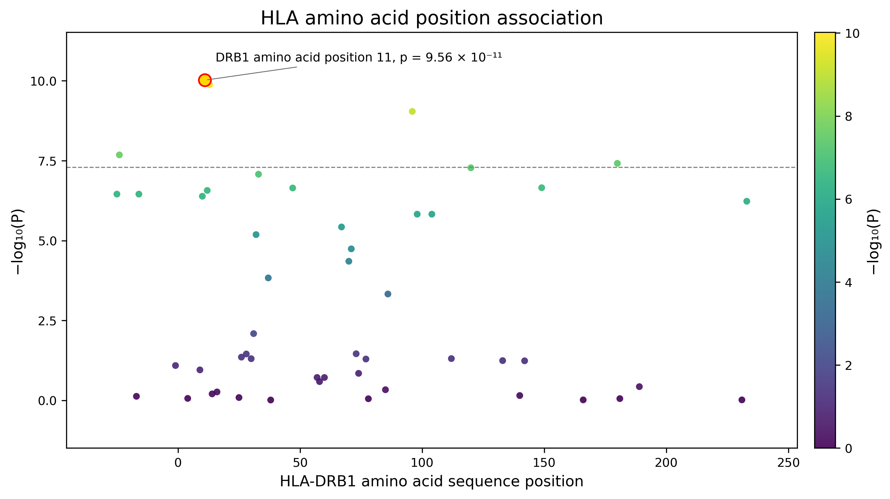
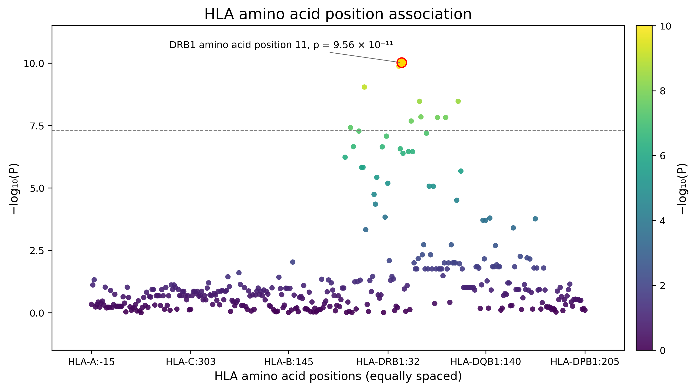
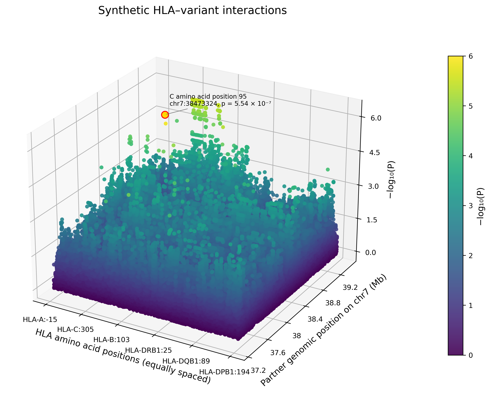

# HLA amino acid position visualisation

`hp.vis.plot_aa_association()` and `hp.vis.plot_aa_interaction()` return `(fig, ax)`.

Matplotlib is the only plotting dependency. Plots are not displayed unless `show=True`.

## Input and significance

An ID such as `AA_DRB1_11_32552129` is parsed into gene DRB1, **amino acid sequence position 11**, 
and **genomic coordinate 32552129**. Plots default to numeric amino acid sequence positions within one gene. Select
`genes="DRB1"`, for example. Use `x_axis="genomic"` for physical genomic spacing
across multiple genes. IDs are case-normalised for gene matching. No genome
assembly or coordinate conversion is inferred; `reference_build="GRCh38"` adds a
label only. Coordinates must all use the same reference build supplied by you.

Only position-level tests are accepted. Residue/exon suffixes are rejected because
a residue test cannot be assumed to represent an omnibus position test. Duplicate
rows for a position raise an error. Obtain position-level tests from the amino acid association
analysis; this module never combines residue P-values. Different genomic coordinates
are preserved even if their gene and sequence position are the same.

For current standard AA and AA omnibus interaction results, explicitly select
`pval_col="P-value"` and `variant_col="VARIANT"`. Pairwise interaction results also use `P-value`, but represent individual
encoded-column tests rather than AA block omnibus tests. Alternatively, supply `log10p_col="META_log10P"`, meaning **positive
−log₁₀(P)**, not log₁₀(P). No test columns are silently mixed by the plotting
functions.

Raw P-values must satisfy `0 < P <= 1`. Strings or Decimal values such as
`"6.09e-412"` are accepted without underflow. A p-value reported as zero may represent an extremely small
non-zero probability that falls below the smallest representable floating-point value: supply a finite −log₁₀(P) instead. 
Labels derive the scientific notation  and exponent directly from the log value; they do not exponentiate
the entire tiny probability. `p_digits=3` controls displayed significant figures.
Accuracy is limited by the precision of the input. P=1 is valid and visible.

## Choosing the X-axis

The same `x_axis` options are available for `plot_aa_association()` and both
`plot_aa_interaction()` modes (`scatter3d` and `heatmap`):

| `x_axis` | Spacing and meaning | Gene selection |
|---|---|---|
| `"amino_acid"` **(default)** | Numeric amino acid sequence positions; gaps reflect differences in sequence position. | Select one gene, e.g. `genes="DRB1"`. |
| `"genomic"` | Actual genomic base-pair coordinates. Positions within genes cluster because inter-gene gaps are much larger. | One or multiple genes. |
| `"equally_spaced"` | Distinct AA positions are ordered by genomic coordinate and spaced evenly, like categorical string plotting. Spacing represents neither genomic nor sequence distance. | One or multiple genes. |

For example, add one of these configurations to either plotting function:

```python
# Numeric sequence positions within HLA-DRB1 (the default axis).
x_axis = "amino_acid"
genes = "DRB1"
```




```python
# Physical genomic spacing across HLA genes.
x_axis="genomic"

# Even spacing across HLA positions, with gene/position tick labels.
x_axis="equally_spaced"
```



`equally_spaced` prints an INFO note on each call explaining that distances are
not represented. In interaction plots, the partner Y-axis remains genomic in all
three modes. `position_unit="Mb"` formats genomic axes only; it does not scale
amino acid sequence positions or equally spaced indices. Changing the axis never
combines P-values or merges distinct genomic records.


## Association plot

This is for plotting amino acid position associations results.

```python
import pandas as pd
import hapy as hp

association = pd.read_csv("examples/visualisation/association.csv")
fig, ax = hp.vis.plot_aa_association(
    association, x_axis="genomic", variant_col="VARIANT", log10p_col="META_log10P",
    highlight_top=True, annotate_p=True, position_unit="Mb",
    title="HLA amino acid position association",
    significance_threshold=5e-8, save_path="association.png",
)

```




`highlight_top=True` selects the strongest hit; `highlight_top=3` selects three.
`highlights=[("B", 63), ("DRB1", 11)]` selects gene and sequence-position pairs;
exact position IDs are also accepted. Gene is always part of tuple matching.
`genes="DRB1"` or `genes=["B", "DPB1"]` filters before selecting top hits.
Multiple coordinates for a selected gene/sequence position are all highlighted.
Missing requested highlights produce a warning.

`significance_threshold` accepts actual P-values (including scientific-notation
strings); `threshold_log10p` instead accepts −log₁₀(P). Either accepts a scalar or
list. `threshold_kwargs` customises the Matplotlib horizontal lines.

## Interaction scatter and sparse heatmap

This is for plotting GxG (amino acid positions and SNP) interaction results.

```python
from matplotlib.colors import Normalize

interactions = pd.read_csv("examples/visualisation/interaction.csv")
hits = [("B", 63, 38175678), ("DPB1", 9, 37289819), ("DPB1", 35, 37289819)]
shared_scale = Normalize(vmin=0, vmax=6)
for kind in ["scatter3d", "heatmap"]:
    fig, ax = hp.vis.plot_aa_interaction(
        interactions, x_axis="genomic", variant_col="AA_VARIANT", partner_pos_col="TCR_POS",
        partner_variant_col="PARTNER", log10p_col="META_log10P",
        kind=kind, highlights=hits, annotate_p=True, position_unit="Mb",
        norm=shared_scale, figsize=(12, 7), annotation_fontsize=8,
        annotation_offsets={
            ("B", 63, 38175678): (8, 12),
            ("DPB1", 9, 37289819): (-230, 45),
            ("DPB1", 35, 37289819): (-230, 95),
        },
        save_path=f"interaction_{kind}.pdf",
    )
```

X is the HLA position's genomic coordinate; Y is the partner genomic coordinate.
The 3D Z-axis and all point colours are −log₁₀(P). Annotation labels include the
HLA gene, sequence position, partner information, and actual P-value.
`partner_variant_col` can be parsed without an explicit position column for IDs
such as `chr7:38175678`, `chr7_38175678_A_G`, or `SNP_A_7_38175678_exon1`.
rsIDs need `partner_pos_col`. When both sources provide coordinates, disagreements
are rejected. `partner_chrom="7"` supplies a chromosome label when only numeric
positions are available; chromosomes are otherwise derived only from partner IDs.
Coordinates spanning multiple partner chromosomes are rejected: filter to one
chromosome per plot to avoid overlaying unrelated chromosome axes.

Heatmaps are **sparse point heatmaps**: squares centred on exact observed coordinate
pairs. They do not form a raster, interpolate missing combinations, or assume equal
spacing. 
- Background (`missing_color`) indicates unobserved combinations; observed non-significant values remain coloured. Point size is in display units, not genomic bin width. 
- Reduce `marker_size` or zoom in if nearby observations overlap. 
- There is no binning performed. 
- `annotate_cells=True` labels every observed point; otherwise only highlighted points are labelled.

Repeated coordinate pairs are preserved by default (`duplicate="keep"`). Distinct
partner variants can share a genomic coordinate. In 3D they retain their individual
significance heights. In the heatmap all points remain, with a warning that one
point can cover another; coordinates are never shifted. Filter specific variants
for an unambiguous 2D view. Explicit `duplicate="error"` rejects repeats, while
`duplicate="max"` warns and selects the largest −log₁₀(P) per pair (ties keep the
first input row). This optional visual aggregation does not combine P-values.

## Plot input parameters

Defaults below are the function defaults. For current hapy result tables,
explicitly select `variant_col="VARIANT"` and `pval_col="P-value"`, or provide
`log10p_col` for meta-analysis results. Input identifiers and significance values
must follow the requirements above.

### `plot_aa_association()`

| Parameter | Type | Default | Description |
|---|---|---|---|
| `data` | `pandas.DataFrame` | **Required** | Position-level results. Input is not modified; filter out residue OVR rows before plotting. |
| `variant_col` | `str` | `"VARIANT"` | AA position identifier column. For current hapy outputs, set `variant_col="VARIANT"` explicitly; interaction meta IDs may include `AA_ID*partner`. |
| `pval_col` | `str` or `None` | `None` | Raw P-value column, mutually exclusive with `log10p_col`. Set to `"P-value"` for current results; if neither significance column is supplied, the code uses `"LR_p"`. |
| `log10p_col` | `str` or `None` | `None` | Finite nonnegative minus-log10(P) column, such as `"META_log10P"`. Mutually exclusive with `pval_col`. |
| `genes` | `str`, iterable of `str` or `None` | `None` | Case-insensitive gene selection. Numeric amino acid X coordinates require a single gene in the selected data. |
| `x_axis` | `str` | `"amino_acid"` | `"amino_acid"`, `"genomic"` or `"equally_spaced"`; see X-axis layouts above. |
| `highlights` | iterable or `None` | `None` | Selected gene/position tuples or exact position IDs. Interaction tuples also include the partner genomic position. |
| `highlight_top` | `bool` or `int` | `False` | `True` highlights the strongest result; a positive integer selects the top N; `False` disables automatic selection. |
| `annotate_p` | `bool` | `True` | Show automatic labels on highlighted points. `False` permits highlighting without automatic annotations. |
| `annotations` | mapping, callable or `None` | `None` | Custom text keyed by highlight identifiers, or a callable receiving a parsed row. A callable may return `None` to omit its label. |
| `annotation_offsets` | mapping or `None` | `None` | Highlight keys mapped to `(dx, dy)` label offsets in points. |
| `significance_threshold` | scalar, iterable or `None` | `None` | Raw P-value threshold for a horizontal line. Mutually exclusive with `threshold_log10p`. |
| `threshold_log10p` | scalar, iterable or `None` | `None` | Threshold already expressed as minus log10(P). |
| `threshold_kwargs` | mapping or `None` | `None` | Matplotlib styling for the threshold line. |
| `ax` | Matplotlib `Axes` or `None` | `None` | Existing 2D axes for association/heatmap or 3D axes for scatter3d. `None` creates a figure and axes. |

### `plot_aa_interaction()`

| Parameter | Type | Default | Description |
|---|---|---|---|
| `data` | `pandas.DataFrame` | **Required** | Position-level results. Input is not modified; filter out residue OVR rows before plotting. |
| `variant_col` | `str` | `"AA_VARIANT"` | AA position identifier column. For current hapy outputs, set `variant_col="VARIANT"` explicitly; interaction meta IDs may include `AA_ID*partner`. |
| `partner_pos_col` | `str` or `None` | `None` | Partner genomic base-pair position column. Required when partner IDs cannot provide coordinates. |
| `partner_variant_col` | `str` or `None` | `None` | Partner ID column used for labels and coordinate parsing. Parseable IDs must agree with an explicitly supplied position column. |
| `partner_chrom` | `str`, `int` or `None` | `None` | Explicit partner chromosome for labels and consistency checks; otherwise inferred from parseable partner IDs. |
| `pval_col` | `str` or `None` | `None` | Raw P-value column, mutually exclusive with `log10p_col`. Set to `"P-value"` for current results; if neither significance column is supplied, the code uses `"LR_p"`. |
| `log10p_col` | `str` or `None` | `None` | Finite nonnegative minus-log10(P) column, such as `"META_log10P"`. Mutually exclusive with `pval_col`. |
| `kind` | `str` | `"scatter3d"` | Interaction rendering mode: `"scatter3d"` or `"heatmap"`. |
| `genes` | `str`, iterable of `str` or `None` | `None` | Case-insensitive gene selection. Numeric amino acid X coordinates require a single gene in the selected data. |
| `x_axis` | `str` | `"amino_acid"` | `"amino_acid"`, `"genomic"` or `"equally_spaced"`; see X-axis layouts above. |
| `highlights` | iterable or `None` | `None` | Selected gene/position tuples or exact position IDs. Interaction tuples also include the partner genomic position. |
| `highlight_top` | `bool` or `int` | `False` | `True` highlights the strongest result; a positive integer selects the top N; `False` disables automatic selection. |
| `annotate_p` | `bool` | `True` | Show automatic labels on highlighted points. `False` permits highlighting without automatic annotations. |
| `annotations` | mapping, callable or `None` | `None` | Custom text keyed by highlight identifiers, or a callable receiving a parsed row. A callable may return `None` to omit its label. |
| `annotation_offsets` | mapping or `None` | `None` | Highlight keys mapped to `(dx, dy)` label offsets in points. |
| `duplicate` | `str` | `"keep"` | Coordinate-repeat policy: `"keep"`, `"error"` or `"max"`. `max` is explicit visual aggregation, not a combined test. |
| `annotate_cells` | `bool` | `False` | Annotate observed heatmap points with formatted P-values. Has no effect on scatter3d. |
| `ax` | Matplotlib `Axes` or `None` | `None` | Existing 2D axes for association/heatmap or 3D axes for scatter3d. `None` creates a figure and axes. |

## Annotations and styling

`annotate_p=False` highlights without default labels. `annotations` can be a mapping
from highlight tuples (or position IDs) to custom text, or a callable receiving a
copy of the parsed row (`id`, `gene`, `aa_pos`, `x`, `score`, and interaction `y` /
`partner_label`). A callable can return None to omit a label. Custom text replaces
the entire default label. Labels use heuristic screen-space placement, with explicit offsets available for
fine adjustments. `annotation_offsets` maps highlight keys to `(dx, dy)` offsets in
points; use it for dense figures. 3D labels are reprojected on every draw/view change.

Shared styling keywords (passed directly to either plotting function):

| Parameter | Type | Default | Description |
|---|---|---|---|
| `figsize` | tuple of two numbers | `(9, 5)` | New figure width and height in inches. |
| `dpi` | `int` | `300` | Figure and default export resolution. |
| `title` | `str` or `None` | `None` | Figure title; `None` leaves the title blank. |
| `title_size` | number | `14` | Title font size in points. |
| `title_weight` | `str` or number | `"normal"` | Title font weight. |
| `xlabel` | `str` or `None` | `None` | X-axis label; `None` generates the label from the selected coordinates. |
| `ylabel` | `str` or `None` | `None` | Y-axis label; `None` generates the plot label. |
| `zlabel` | `str` or `None` | `None` | 3D Z-axis label; `None` uses minus log10(P). |
| `label_size` | number | `11` | Axis-label font size in points. |
| `label_weight` | `str` or number | `"normal"` | Axis-label font weight. |
| `tick_size` | number | `9` | Tick-label font size in points. |
| `x_ticks` | `int` | `6` | Approximate maximum X tick intervals. |
| `y_ticks` | `int` | `6` | Approximate maximum Y tick intervals. |
| `z_ticks` | `int` | `5` | Approximate maximum 3D Z tick intervals. |
| `cmap` | `str` or Matplotlib colormap | `"viridis"` | Significance colour map. |
| `norm` | Matplotlib `Normalize` or `None` | `None` | Shared colour normalisation. Do not combine with explicit `vmin`/`vmax`. |
| `vmin` | number or `None` | `None` | Colour-scale lower limit; `None` uses zero unless `norm` is supplied. |
| `vmax` | number or `None` | `None` | Colour-scale upper limit; `None` uses the largest score, at least one, unless `norm` is supplied. |
| `marker` | Matplotlib marker or `None` | `None` | `None` selects circles for scatter plots and squares for heatmaps. |
| `marker_size` | number or `None` | `None` | Marker area in points squared; `None` selects 25 for scatter plots or 100 for heatmaps. |
| `alpha` | number | `0.9` | Ordinary point opacity, from zero to one. |
| `edgecolor` | Matplotlib colour | `"none"` | Ordinary marker edge colour. |
| `linewidth` | number | `0.5` | Ordinary marker edge width. |
| `highlight_color` | Matplotlib colour | `"gold"` | Default highlighted-point fill. |
| `highlight_facecolor` | Matplotlib colour or `None` | `None` | Explicit highlight fill overriding `highlight_color` when supplied. |
| `highlight_edgecolor` | Matplotlib colour | `"red"` | Highlighted-point outline colour. |
| `highlight_linewidth` | number | `1.2` | Highlighted-point outline width. |
| `highlight_alpha` | number | `1.0` | Highlighted-point opacity. |
| `highlight_size` | number or `None` | `None` | Highlighted marker area; `None` uses max(80, 2.5 times ordinary marker size). |
| `colorbar` | `bool` | `True` | Draw a significance colour bar. |
| `colorbar_label` | `str` | `"\u2212log\u2081\u2080(P)"` | Colour-bar label. |
| `annotation_style` | `str` | `"full"` | `"full"` or `"compact"` automatic annotation text. |
| `annotation_partner` | `bool` | `True` | Include partner information in interaction annotations. |
| `annotation_avoid_overlap` | `bool` | `True` | Apply heuristic automatic label placement. |
| `annotation_fontsize` | number | `9` | Annotation font size in points. |
| `annotation_offset` | tuple of two numbers | `(8, 12)` | Default `(dx, dy)` label offset in points. |
| `annotation_arrows` | `bool` | `True` | Draw annotation connectors. |
| `annotation_kwargs` | mapping | `{}` | Additional Matplotlib annotation text properties. |
| `xlim` | tuple of two numbers or `None` | `None` | X limits in selected coordinate units: sequence position, genomic bp or zero-based ordinal indices. |
| `ylim` | tuple of two numbers or `None` | `None` | Y limits: minus log10(P) for association, genomic bp for interaction. |
| `zlim` | tuple of two numbers or `None` | `None` | 3D Z limits in minus log10(P). |
| `position_unit` | `str` | `"bp"` | Genomic tick units: `"bp"` or `"Mb"`. Does not rescale numeric sequence positions or supplied axis limits. |
| `xformatter` | Matplotlib formatter, callable or `None` | `None` | Custom X tick formatter; a callable receives `(value, tick_position)`. |
| `yformatter` | Matplotlib formatter, callable or `None` | `None` | Custom interaction Y genomic tick formatter. |
| `reference_build` | `str` or `None` | `None` | User-supplied genome-build label only; no coordinate conversion. |
| `rasterized` | `bool` | `False` | Rasterise scatter artists when exporting; leave false for fully vector points. |
| `elev` | number | `25` | 3D viewing elevation in degrees. |
| `azim` | number | `-60` | 3D viewing azimuth in degrees. |
| `missing_color` | Matplotlib colour | `"#eeeeee"` | Sparse heatmap background for unobserved coordinates. |
| `save_path` | `str`, `pathlib.Path` or `None` | `None` | Optional PNG/PDF/SVG output path. Parent directory must exist. |
| `save_kwargs` | mapping | `{}` | Additional Matplotlib `savefig` options. |
| `show` | `bool` | `False` | Display the figure after creation. |
| `p_digits` | `int` | `3` | Significant figures in formatted P-value labels. |

`ax=` accepts an existing 2D axes for association/heatmap, or a 3D axes for scatter3d.
With existing axes, their figure size/layout is retained; `figsize` applies only to
new figures. All functions return the same figure and axes for further editing.
No global Matplotlib style/backend is changed. For vector publication output leave
`rasterized=False` and save PDF/SVG; PNG resolution uses `dpi`. Save directories must
already exist. Figures remain open for the caller to modify or close.

## Reproduce examples and checks

From the repository root:

```bash
MPLBACKEND=Agg python examples/visualisation/plot_examples.py --output /tmp/hapy_figures
python -m pytest tests/test_vis.py
```

The example CSVs are **synthetic** and demonstrate plotting, not scientific findings.
The script writes all three plot modes in PNG, PDF and SVG.